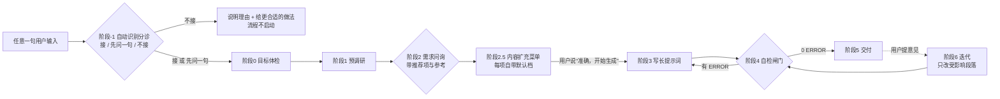

# prompt-forge 工作规范

> 这是本仓库的核心文件，也是唯一权威。AI 编程工具（Claude Code / Cursor / Codex / DSH / Gemini CLI 等）
> 打开本目录后，必须**先把本文件从头读到尾**，再按下面的阶段推进。各阶段方法在 `references/`，按需读取。

## 0. 这个仓库是什么

把**用户一句话的模糊需求**，经过一轮问询拍板，变成**另一个 AI 拿到就能直接开工的长提示词**。

交付物（都在输出目录里）：

| 文件 | 是什么 |
| --- | --- |
| `prompt.md` | **长提示词本体，唯一事实来源**。用户复制它去开新对话/新会话，对方 AI 不读本次对话也能照做 |
| `需求确认.md` | 用户拍板的每一项 + 每一轮修改意见（原话）+ 本次调研到的已知事实 |
| `问询记录.md` | 可选：问过的题、用户的选择、被跳过的问题与理由 |

注意两者的区别：`需求确认.md` 是**给人看的过程记录**，`prompt.md` 是**给 AI 看的执行指令**。
用户真正要带走的是 `prompt.md`。

### 六条总原则

1. **不许替用户拍板。** 拿不准的要么问，要么写进「假设与开放问题」段并标 `未确认` —— 静默假设是最贵的 bug。
2. **一切模糊形容词都要落成可判定的东西。** 「快」→「P95 ≤ 200 ms」；「好看」→ 参照物 + 具体色值/字阶；
   落不下来就回去问用户要参照物，不许原样写进需求。
3. **需求和验收必须一一对应。** 每条 `A#` 至少引用一个 `R#`，每条 `A#` 必须有 `判定：`。
4. **提示词是给陌生人看的。** 禁止「上面说的」「之前那个」「你也知道」——本次对话里的上下文，
   对方 AI 读不到，必须写全（路径、版本、文件名、口径）。
5. **能自己查的不问用户。** 先读工作区、读仓库、查公开资料；只问「只有用户本人能回答」的问题。
6. **不许套模板。** 12 段契约是骨架，不是答案；每个需求都要重新推导技术约束与验收标准。

## 1. 两种用法与路径约定

| 用法 | `<工具目录>` | `<工作区>` | `<输出目录>` |
| --- | --- | --- | --- |
| 克隆仓库 | 本仓库根目录 | 本仓库根目录 | `输出/<slug>/` |
| 安装成 Skill | `SKILL.md` 所在目录 | 用户当前项目根目录 | `<工作区>/提示词/<slug>/` |

- `<slug>` 是需求短名，全小写 + 连字符，例如 `download-tidy`、`class-signup`。一个 slug 一个目录，永不混用。
- **永远不要写进 `<工具目录>`**：工具目录是只读的规范与脚本，产物一律落在 `<输出目录>`。
- Skill 用法下提醒用户把 `<工作区>/提示词/` 加进 `.gitignore`（里面是过程产物，通常不该进业务仓库）。

## 2. 目录结构

```text
prompt-forge/
├── AGENTS.md            # 本文件：工作规范（唯一权威）
├── SKILL.md             # 安装成 Agent Skill 时的入口
├── CLAUDE.md            # 让 Claude Code 也读 AGENTS.md
├── README.md            # 给人看的说明
├── references/          # 方法论：需求问询 / 提示词结构 / 参考样例库 / 模糊词换算表 / 校验清单 / 踩坑记录 / 方法论出处
├── templates/           # 提示词骨架、需求确认模板
├── scripts/
│   ├── check_prompt.py  # 闸门①：检查长提示词本身是否符合 12 段契约
│   └── check_skill.py   # 闸门②：检查本技能自己的定义（SKILL.md 能否被自动识别）
├── examples/            # 闸门①的正反例（正例必须过闸门）
│   └── 技能定义/         # 闸门②的正反例：1 正 8 反，预期 ERROR/WARN 码见该目录 README
└── 输出/                # 克隆用法下的产物目录（git 忽略）
```

## 3. 流程总览



### 阶段 -1 · 自动识别与分诊（决定「接不接」，先于一切）

本技能**不靠固定咒语触发**：宿主把 `name` + `description` 交给模型，模型按语义判断这次输入该不该用本技能
（机制与出处见 `references/方法论出处.md` 第 4.5 节）。接住之后的第一件事，是**把判断说出口**。

判据三条，全部当场可答、不用问用户：

1. **有没有能落下来的交付物？**（路径 / 格式 / 数量，至少能推出一个）
2. **是不是一次任务级的活？**（不是改一个词、跑一条命令；也不是「同时上十个模块」这种该拆的）
3. **缺的信息能不能自己查到？**（读工作区、读仓库、查资料能确定的，不算缺口）

三态（对齐 spec-kit assessment 的 `go` / `needs-clarification` / `kill`）：

| 态 | 触发条件 | 动作 |
| --- | --- | --- |
| **接 `go`** | 是可执行的活，关键信息基本齐 | 直接进阶段 0 |
| **先问一句 `needs-clarification`** | 像是个活，但连「要做什么」都还没定 | 只问那**一个决定性前提**，答完再进阶段 0 |
| **不接 `kill`** | 单步任务 / 纯问答检索翻译闲聊 / 用户明确说别问、直接干 / 需求已经精确到可直接执行 | **一句话**说明理由 + 给出更合适的做法（直接执行、换个工具、或直接给答案），流程不启动 |

- 判断必须**显式说给用户听**（一句话就够），不许心里判断完直接开问。
- 不确定就默认「接」，但第一句就问最贵的那件事：**不许因为不确定就不接，也不许图省事就跳过问询**。
- 判成「接」不等于问满一轮：题目数量按缺口裁剪（`references/需求问询.md` 第 1 节）。
- 判成「先问一句」时，那一句**不算阶段 2 的问询配额**，但它决定要不要真的启动流程。

### 阶段 0 · 目标体检（不打扰用户）

先确定三件事，写进 `需求确认.md` 开头：

1. **谁执行这条提示词**：Claude Code / Cursor / DSH / 通用 LLM / 人？——决定要不要写「先读 `AGENTS.md`」「用 `gh` 提交」这类只对特定工具成立的话。
2. **产物落在哪里**：新建仓库 / 现有仓库（哪个目录）/ 只要一段文本。
3. **手上已有什么上下文**：仓库、README、接口文档、截图、旧提示词、报错日志。有就先读，读完再问。

### 阶段 1 · 预调研（不打扰用户，但必须做）

把「已知 / 未知」列成两清单（写进 `需求确认.md`），未知项就是阶段 2 的题库来源。来源优先级：

1. 用户原话里已经说过的（**同一件事问第二遍是最低级的失误**）
2. `<工作区>` 里的文件与代码（技术栈、目录约定、现有依赖、代码风格）
3. 公开资料（平台硬限制、库的版本与授权、竞品做法）

判据：**能靠读文件或查资料确定的，不许出现在问题里。**

### 阶段 2 · 需求问询（**唯一强制卡点**）

规则（细节与题库见 `references/需求问询.md`，可直接抄的选项见 `references/参考样例库.md`）：

- **优先压到 5 题以内，一轮问完**（GitHub spec-kit 的 `/clarify` 就是"一轮 ≤5 个针对性问题"的口径）；
  复杂需求最多 9 题、最多两轮，超过上限就把次要项改成默认值并标注。
- 每题格式：`题号 + 题目 + 3~4 个选项（首项是带理由的推荐项）+ "都可以 / 你决定"兜底`。
- 至少一半的题必须是**选择题**；开放题最多 2 个（例如「有没有必须参考的竞品/界面截图」）。
- 给参考的三种方式：① **选项菜单**（从 `references/参考样例库.md` 里挑）② **参照物**（截图、链接、竞品名）③ **反例**（「不要做成 XXX 那样」）。
- 用户答「你决定」/「都行」：**给一个默认值 + 写进假设段并标 `未确认`**，绝不静默假设。
- 必问题（视需求形态裁剪，但顺序与理由要保留）见 `references/需求问询.md` 第 3 节。
- 非功能需求不要凭空想：照 `references/需求问询.md` 第 4.5 节的**九维清单**（ISO/IEC 25010:2023）逐维过一遍，只把与本次需求真正相关的维度变成问题。
- 问完把结论写进 `需求确认.md`，然后进阶段 2.5（内容扩充菜单）；
  **等用户明确说「准确，开始生成」之后才允许进阶段 3**。

### 阶段 2.5 · 内容扩充菜单（问「写多厚」，不问「做什么」）

问询解决的是「**做什么**」——缺了就没法开工，而且只有用户能回答；扩充菜单解决的是「**这份提示词写多厚**」——
缺了照样能开工，每一项都有默认档兜底。两者不要混：**菜单里不许出现只有用户能回答的问题**，那类问题属于阶段 2。

做法（选项直接抄 `references/参考样例库.md` 的 K 组，细节见 `references/需求问询.md` 第 7 节）：

1. 按需求形态取 **6~8 项**（菜单最多 12 项），每项一行：`[默认 要/不要] 项目名 —— 代价：加什么、加多少`。
2. 首行给总说明与兜底：`这份提示词要不要包含下面这些？不勾的就按默认走；嫌麻烦直接说「全按默认」。`
3. 用户没回 / 回「都可以 / 你决定 / 全按默认」→ **照默认档走**，并把每一项的决定记进 `需求确认.md` 第 3.5 节。
4. 勾掉的项不许凭空消失：
   - 属于该需求形态的常见项（例如「不要错误处理」）→ 写进 `prompt.md` 第 5 段非目标；
   - 只是这次不需要 → 写进第 10 段假设，标 `未确认` + 默认取值。
5. 菜单结束就是**唯一强制卡点的确认点**：把「问询结论 + 菜单勾选 + 假设清单」一起复述，等用户回「准确，开始生成」。

> 出处与本仓库的取舍：官方建议是 "Provide defaults, not menus"（给人默认值，而不是让人做选择题）。
> 本仓库保留菜单，但**把菜单限制在「写多厚」这一层**，且**每一项都必须自带默认档**——
> 用户一个都不选，结果与「直接给默认值」一致。这条折中的出处记在 `references/方法论出处.md` 第 4.5 节。

### 阶段 3 · 写长提示词

按 `references/提示词结构.md` 的 **12 段契约**写，骨架直接抄 `templates/提示词骨架.md`。

- 需求逐条编号 `R1..Rn`；验收逐条编号 `A1..An`；**每条 A# 都要写 `判定：`**（命令 / 阈值 / 人工，三选一）。
- 背景段的每个事实标来源：`[用户原话]` / `[仓库实测]` / `[外部资料 URL]` / `[AI 推断]`。
- 非目标段必须写实（写「不做 X」而不是「无」）。
- 撞到模糊词，按 `references/模糊词换算表.md` 换算成数字；换算不出来的回去要参照物。

### 阶段 4 · 自检闸门（**不许跳步**）

```bash
python scripts/check_prompt.py <输出目录>/prompt.md
```

- **必须 0 ERROR 才算通过**；WARN 要在交付回复里**逐条列出**，每条都写清为什么不影响执行（话术模板见 `references/校验清单.md` 第三节）。
- 再过一遍 `references/校验清单.md` 的人工复核项，最要紧的是这三条：
  ① 把本次对话全部拿掉，另一个 AI 能不能只靠 `prompt.md` 读懂；
  ② 每条需求是不是都有验收；③ 有没有偷偷替用户拍板。
- 这一步是长提示词的**编译期**。没过闸门不许交付。

### 阶段 5 · 交付

给用户三样东西，缺一不可：

1. **长提示词全文**（放在回复里，可直接整段复制；不要只说「已写入文件」）
2. **落盘路径**：`<输出目录>/prompt.md`
3. **最可能返工的三处**：哪些地方是 AI 推断的、用户改一句话要连带改哪些段落

### 阶段 6 · 迭代

把用户意见**原话**记进 `需求确认.md`，判断影响范围，只重做必要段落，然后重跑闸门：

| 改动 | 需要重做 |
| --- | --- |
| 补一个需求 | 需求段 + 对应验收段 + 步骤段 → 重跑闸门 |
| 改技术栈 | 技术约束段 + 步骤段 + 验证方式段 → 重跑闸门 |
| 改验收口径 | 只改验收段与验证方式段 → 重跑闸门 |
| 需求整体换方向 | 回到阶段 1 重新预调研，`prompt.md` 推倒重写 |

## 4. 长提示词的 12 段契约（**唯一事实来源**）

`prompt.md` 必须包含下列 12 段（标题可就近措辞，但语义齐全；`check_prompt.py` 按语义关键词匹配）：

| # | 段落 | 必须写什么 | 判定 |
| --- | --- | --- | --- |
| 1 | 角色与目标 | 一句话目标 + 「做完算成功」的定义 | 目标可判定，不是「做得更好」 |
| 2 | 背景与已知事实 | 每个事实带来源标记 | 无来源的断言一律视为推断 |
| 3 | 交付物 | **精确路径 + 格式 + 数量** | 至少一个带扩展名的路径 |
| 4 | 需求（R#） | 逐条编号，每条可验证 | ≥3 条，编号唯一 |
| 5 | 非目标 | 明确不做什么 | 不许写「无」 |
| 6 | 技术约束 | 语言/版本/依赖/目录/风格/禁止项 | 版本写具体数字 |
| 7 | 验收标准（A#） | 每条引用 R#，每条有 `判定：` | ≥3 条，全部被 R# 覆盖 |
| 8 | 验证方式 | 可复制的命令 + 期望输出 | 命令必须能真跑 |
| 9 | 执行步骤 | 阶段化，每步产物 + 可中断点 | 顺序可执行，无循环依赖 |
| 10 | 假设与开放问题 | 显式标 `未确认` 与默认取值 | 不许留空 |
| 11 | 何时必须停下来问人 | 触发条件（不是「遇到问题就问」） | 条件可识别 |
| 12 | 汇报格式 | AI 完成后按什么格式回话 | 三件套：改了什么/怎么验的/还剩什么 |

约定：

- `R#` / `A#` 编号在本文件内唯一、不复用；新增需求**追加编号**，不要重排（避免用户对不上号）。
- `判定：` 只有三种取值 —— **命令**（贴命令 + 期望输出）、**阈值**（指标 + 数字 + 测量方法）、**人工**（谁看、看什么、什么算过）。
- 全篇用**绝对路径或相对于仓库根的路径**，禁止「合适的位置」「相应目录」。
- 阶段 2.5 的菜单勾选结果必须落到对应段落：勾「要性能预算」→ 第 6 段写数字、第 7 段写判定；
  勾「不要」→ 第 5 段非目标写明；没确认的 → 第 10 段标 `未确认`。

## 5. 机器闸门与退出码

| 闸门 | 通过条件 |
| --- | --- |
| `check_prompt.py` | **0 ERROR**（WARN 可接受，但要逐条说明） |
| `python scripts/check_prompt.py --selftest` | 正例 0 ERROR、反例 ≥5 ERROR、`templates/提示词骨架.md` 也是 **0 ERROR 0 WARN**（改了脚本 / 示例 / 模板必须重跑） |
| `check_skill.py <SKILL.md>` | **0 ERROR**（检查本技能自己的定义：name 与目录名一致、description 能在 500 字内被自动识别、正文写了分诊与默认档；改 `SKILL.md` 后必须重跑） |
| `python scripts/check_skill.py --selftest` | 仓库里真实的 `SKILL.md` 0 ERROR、每个反例用例报出的 ERROR 码与预期一致 |

脚本一律：**发现问题就非零退出并打印 `ERROR: ...` 行**，不要静默通过。

## 6. 参考文档

| 文档 | 什么时候读 |
| --- | --- |
| `references/需求问询.md` | 阶段 2 开始前（怎么问、问什么、题库），以及阶段 2.5（扩充菜单与收尾） |
| `references/参考样例库.md` | 阶段 2 给用户选项时、阶段 2.5 给扩充菜单时（可直接抄的菜单与参照物） |
| `references/提示词结构.md` | 阶段 3 动手写之前（12 段逐段写法与正反例） |
| `references/模糊词换算表.md` | 阶段 3 撞到「快/好看/稳定」这类词时 |
| `references/校验清单.md` | 阶段 4，以及交付前 |
| `references/踩坑记录.md` | 开工前通读一遍，别重复踩 |
| `references/方法论出处.md` | 想知道「这条规矩是哪来的 / 哪些是本仓库自己的取舍」时（自动识别与菜单的出处在第 4.5 节；也是对外解释的依据） |

## 7. 执行者红线

1. 不问用户**能自己查到**的事（先读文件、先查资料）；同一件事不问第二遍。
2. 不超 9 题（能压到 5 题更好）；不把用户当成需求分析师（让他挑，不让他写）。
3. 不替用户拍板；不确定就标 `未确认`。
4. 不用形容词交差（「美观」「高性能」「尽量简洁」）。
5. 不在提示词里写「上面提到过」「之前说的」。
6. 不跳闸门；不把反例当模板抄。
7. 不交付没有 `判定：` 的验收标准。
8. 不做分诊就直接开问，或者分诊了却不说出来（阶段 -1 的判断要显式说给用户听）。
9. 不把扩充菜单做成「让用户配置一切」：每项必须自带默认档，用户不选就按默认走并在假设段标注。
10. 不让被勾掉的项凭空消失：进不了提示词，就进第 5 段非目标或第 10 段假设。
11. 改了 `SKILL.md` 的 `name` / `description` 却不重跑 `scripts/check_skill.py`。
