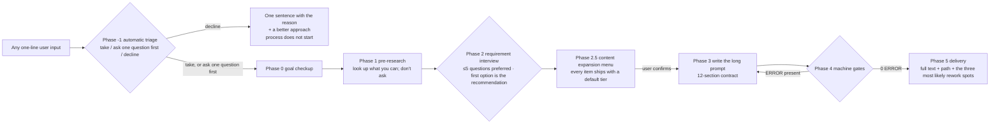

# prompt-forge

[](LICENSE)
[](https://github.com/hwy-miaomiao/prompt-forge/actions/workflows/ci.yml)

**English** | [简体中文](README.md)

**Turn “help me build X” into a long prompt an AI can start from immediately.**

**In one line: requirement clarification → 12-section contract → machine gates.** It is neither a prompt-template collection nor a replacement for spec-kit — it is the **upstream** of spec-kit `/specify`: clarify the fuzzy ask into a long prompt a stranger can execute, then hand it to the SDD flow to plan and build.

**Name-clash note:** there is another `insaaniManav/prompt-forge` on GitHub (a prompt-engineering workbench written in Go; unrelated to this project). This repo is by hwy-miaomiao; its artifacts are `prompt.md` + `需求确认.md`, and its four zero-dependency gates (plus a single-entry `scripts/check.py`) live in `scripts/`.

Most people use AI like this: throw one sentence at it → the AI guesses → what comes out is wrong → argue for three more rounds. The problem is not the AI's capability; it is that **the requirement was never stated clearly**: no deliverable path, no acceptance criteria, no boundaries, no "definition of done". prompt-forge turns "stating it clearly" into an executable process:

> Any one-line requirement → **automatic triage** (take it if it should be taken; if not, explain why in one sentence) → one round of interview with recommended options and reference options (≤5 questions preferred, 9 max) → an expansion menu for "how thick to write it" (every item ships with a default tier) → a 12-section long prompt → gates ①, ③ and ④ at 0 ERROR → delivery.

**No trigger phrases to memorize.** It is not triggered by fixed patterns like "help me build X": the host hands the skill's `name` + `description` to the model, and the model decides semantically whether this input should use the skill. That is why the description states both "when to use it" and "when not to use it" — when triage says it should not be used, it says one sentence and suggests a better approach; it does not start the process on its own.

---

## What problem it solves

| Thrown straight at AI | Run through prompt-forge |
| --- | --- |
| "Tidy up my Downloads folder" | 4 classification rules + same-name conflict policy + list of files to leave untouched + idempotence requirement |
| "Make it look good and fast" | A reference-object path + color and font-size tokens + "1284 files in ≤ 60 seconds" + a measurement method |
| "Don't delete anything" | 5 non-goal items + acceptance "file-count delta = 0" + stop-when-triggered checkpoints |
| "It's done" | Every requirement paired with an acceptance item carrying `判定：` (verdict), with the command and result pasted per item |
| Rework by arguing | All unconfirmed items are marked in the "Assumptions and Open Questions" section, with default values and the cost of changing them |

It is not about "writing longer"; it is about **making every sentence decidable**.

## How it works



Nine key designs:

1. **No trigger phrases to memorize**: the only routing surface is `description` in `SKILL.md`, and the model decides semantically whether to use the skill. Once it takes a request, the first thing it does is **state the judgment out loud** — take (`go`) / ask one question first (`needs-clarification`) / decline (`kill`); the three states follow GitHub spec-kit's terminology. Three criteria: is there a deliverable that can be pinned down; is it a task-level job; can the missing information be looked up by itself.
2. **The interview is the only mandatory checkpoint**: without the user's explicit "accurate, start generating", it may not start writing the prompt.
3. **Let the user pick, not write**: 3–4 options per question, the first is **a recommended option with a reason**; it also offers reference objects and counterexamples (menu in [`references/参考样例库.md`](references/参考样例库.md)).
4. **The menu only asks "how thick", never "what to do"**: the phase 2.5 expansion menu controls whether this prompt should include things like performance budgets, error handling, or tests — **every item ships with a default tier**, so ticking none of them means taking all defaults (the official line is "Provide defaults, not menus"; for this repo's compromise, see section 4.5 of [`references/方法论出处.md`](references/方法论出处.md)).
5. **The prompt is written for a stranger**: delete this entire conversation, and another AI reading only this file must still be able to start.
6. **Every rule is sourced**: `references/方法论出处.md` states item by item whether something is official documentation, an industry standard, or this repo's own design choice — what is borrowed and what is made up is visible at a glance.
7. **The gates are tested too**: all four gates are zero-dependency scripts, and `--selftest` runs them against real positive and negative examples; additionally `scripts/mutate_checks.py` corrupts the gate source in 96 places, and every one of them must turn the corresponding selftest red — this guards against "selftests that run empty, all green while actually checking nothing".
8. **The process record goes through a gate too**: the triage state, the five-step evidence chain (intake → research → define → shape → decide), the interview mode, and each question's method source plus the `prompt.md` section it feeds are written into `需求确认.md` and checked field by field by gate ④. The interview also stops being improvised — `references/需求问询-方法映射.md` and `scripts/pick_methods.py` map the requirement shape and gaps to methods with default tiers.
9. **Single entry + machine-verifiable iteration evidence**: `scripts/check.py` auto-detects `.prompt.md` / requirement-confirmation docs / `SKILL.md` (or a skill directory), runs the matching gates, and prints one summary table with one exit code (`--json` for CI) — the answer to spec-kit / OpenSpec "one command runs the whole flow", except every step here is offline and deterministic. Skills can also declare `evidence: 2 images` in their frontmatter; gate ② then verifies that the iteration-record sections contain that many **real** image paths (existence, magic bytes/structure, optional minimum size, containment and de-duplication), turning "the agent actually looked" into something a machine can judge.


## Quick start

**Option 1: install as an Agent Skill** (Claude Code / DSH / Cursor and other tools that support Skills)

```bash
npx skills add hwy-miaomiao/prompt-forge
```

Then just state the requirement: "help me build a small tool that automatically organizes meeting minutes".
The skill writes its output to `<你的项目>/提示词/<slug>/` (where `<你的项目>` is your project root; remember to add `提示词/` to `.gitignore`).

**Option 2: clone and use directly**

```bash
git clone git@github.com:hwy-miaomiao/prompt-forge.git
cd prompt-forge
```

Have an AI coding tool open this directory; it reads [`AGENTS.md`](AGENTS.md) first, then executes phase by phase.
Under clone usage the output lands in `输出/<slug>/`.

**First, verify all four gates, the single entry and the interview method library are good**:

```bash
# Single entry: auto-detect the target, run the matching gates, print one summary table + exit code
python scripts/check.py --selftest
# ... 32 cases: classification (filename first, body markers as fallback), clean assets at 0 ERROR,
#     4 negative examples caught (16 / 10 / 3 / 1 ERROR), --json shape, exit-code semantics,
#     directory mode, and the real CLI as a subprocess; an unrecognized file type reports E0
#     instead of passing silently, junction / symlink loops are not followed (and do not crash),
#     a missing path gives rc=2 while --json still prints pure JSON (`missing` list + exit_code 2)

# Gate ①: check the produced long prompt itself (the 12-section contract)
python scripts/check_prompt.py --selftest
# PASS  例1-下载文件夹整理.prompt.md: 0 ERROR（期望 0 ERROR）
# PASS  例2-班级报名网站.prompt.md: 0 ERROR（期望 0 ERROR）
# PASS  例3-logsift-json-export.prompt.md: 0 ERROR（期望 0 ERROR）
# PASS  反例-模糊需求.prompt.md: 16 ERROR（期望 >=5 ERROR）
# PASS  templates/提示词骨架.md: 0 ERROR, 0 WARN（期望 0 ERROR 0 WARN）
# ... 120 cases in total = these 5 real files + 115 built-in regressions (heading binding and
#     hijacking, fuzzy-word exemptions, an R# sample inside a fence not counting as an entry /
#     a heading inside a fence not counting as a section / ~~~ also being a fence,
#     a TODO inside a fence still reporting E10, an A# reference on a continuation line still
#     counting, W8 synonymous-heading ambiguity, an exemption comment only covering WARNs in the
#     same section / a missing reason and a wrong code both reporting E11 / exemptions failing
#     under --no-ignore, a four-backtick fence not closing early, 5-level and setext headings,
#     "A4 paper" not counting as an acceptance number, an indented code block not counting as an
#     entry, same-named sections not sharing exemptions, multi-line exemption comments, UTF-16 BOM,
#     E9 line numbers before a code block not drifting
#     — including a text assertion: when the binding lands on the unnumbered heading, W8 must say
#     which one it picked)

# Gate ②: check the skill's own definition (whether description can be auto-recognized, whether name can make the skill silently fail)
python scripts/check_skill.py --selftest
# PASS  SKILL.md: 0 ERROR（期望 0 ERROR）
# PASS  [闸门] 正例夹具: ERROR 码 []（期望 []）
# ... 88 cases in total (the real SKILL.md + 11 real examples + built-in gate cases; among them
#     24 are iteration-evidence regressions and 1 proves a standalone check_skill.py still runs;
#     2 directory-link cases genuinely run: symlink on Linux, junction on Windows; environments
#     where neither can be created report SKIP, not counted as failures). Built-in cases include
#     line numbers, BOM, long-sentence triggering, `go` not being matched by `good` / `Go 语言`,
#     "不接（kill）" not counting as writing "接", etc.

# Gate ③: check whether the sections line up with each other (requirements↔steps, unconfirmed↔stop conditions, verdict↔command)
python scripts/check_contract.py --selftest
# PASS  [闸门③] 基准件：闸门① 的自测夹具跨段也对得上: ERROR 码 []（期望 []） WARN 码 []（期望 []）
# PASS  [闸门③] C1 引用了不存在的需求号: ERROR 码 ['C1']（期望 ['C1']） WARN 码 []（期望 []）
# ... 57 cases + 2 --no-ignore cases + 1 line-number case + 2 scope-note cases + 2 cross-gate consistency cases + 1 performance case (65 PASS in total)
#     (C1/C3/C6 are ERROR, C2/C4/C5 are WARN; the last two are "scope-note" cases: nothing to check / a requirement exists but section 9 is missing, so C2 has nothing to check)

# Gate ④: check 需求确认.md (the process record: triage / evidence chain / interview mode / method sources / traceability)
python scripts/check_confirm.py --selftest
# ... 71 cases + 2 --no-ignore cases + 1 template negative case (74 PASS in total; a template submitted as-is must be caught)

# Interview method library: methods with default tiers for a requirement shape and its gaps
python scripts/pick_methods.py --selftest
# ... 14 checks

# Mutation test: corrupt the gate source in 96 places; every one of them must make the corresponding selftest red (the selftest did run empty once — see pitfall log #29)
python scripts/mutate_checks.py
```

## What you get

`<输出目录>/prompt.md` — one 12-section long prompt you can copy wholesale into any AI:

| # | Section | Purpose |
| --- | --- | --- |
| 1 | Role and goal | The definition of what counts as success |
| 2 | Background and known facts | Every fact carries a source tag (user's own words / repo measurement / external material / AI inference) |
| 3 | Deliverables | Exact path + format + quantity |
| 4 | Requirements (R#) | Numbered one by one, each verifiable, order is priority |
| 5 | Non-goals | States explicitly what is not done; stops "while we're at it" expansion |
| 6 | Technical constraints | Language version, dependencies, directories, style, prohibitions; model names / versions / API defaults must be checked against official docs, and marked `未确认` if unavailable |
| 7 | Acceptance criteria (A#) | Each references an R#, each has `判定：` (verdict: command / threshold / manual) |
| 8 | Verification method | Commands you can paste directly + expected output |
| 9 | Execution steps | Phased, each step has an artifact, interruptible points marked, each step writes `（对应 R#）` (which R# it serves) |
| 10 | Assumptions and open questions | Explicitly marks `未确认` (unconfirmed) and default values, with a matching stop condition in section 11 for every item; anything genuinely missing that must still be written now is marked `[NEEDS CLARIFICATION: …]` and paired one-to-one with an unconfirmed item |
| 11 | When you must stop and ask a human | Recognizable trigger conditions (catches every item in section 10) |
| 12 | Reporting format | What changed / how it was verified / what is left; self-proof before reporting |

There is also a `<输出目录>/需求确认.md`: every item the user signed off on, the user's own words, and each round of revision feedback with its impact scope; the triage state, the five-step evidence chain, and each question's method source/traceability are recorded there too, and gate ④ checks them.

## What the requirement interview looks like

It is not "what do you want?"; it looks up everything that can be looked up first, asks only what only the user can answer, and gives the user options:

```text
Q3. Delivery form (affects: deliverables section + acceptance section)
- [Recommended] A single Python script + double-click entry — reason: you only asked for "double-click to run", and a script is both easiest to verify and cheapest to maintain
- CLI tool with subcommands (--dry-run / --undo)
- Small app with a UI (needs extra UI work, timeline roughly ×2)
- Either is fine / you decide
```

"You decide" is a legitimate answer too: it becomes an explicit assumption with a default value, not a decision quietly made on the user's behalf.

Questions are not improvised: `references/需求问询-方法映射.md` maps the requirement shape / gap dimensions / risk level to methods and default tiers, or run `python scripts/pick_methods.py --shape web --gaps 交付物,验收`. When a job spans several subsystems, or the user explicitly wants to go deep, switch to **one-question-at-a-time** mode (each message asks exactly one open question, with no option list; rules in section 10 of `references/需求问询.md`).

## Machine gates

Delivering `prompt.md` requires gates ①, ③ and ④ all at 0 ERROR; gate ② is run separately after changing `SKILL.md` / `AGENTS.md` / `references/`; plus a mutation test specifically proving these four selftests (and the interview method library) do not run empty.

**Gate ①: the long prompt itself**

```bash
python scripts/check_prompt.py <输出目录>/prompt.md
```

Here `<输出目录>`: under clone usage it is `输出/<slug>/`; under Skill usage it is `提示词/<slug>/` (see “Quick start” above).

It catches these structural problems: missing sections, too few requirements/acceptance items, duplicate numbers, acceptance not referencing requirements, acceptance without a decision method, requirements not covered by acceptance, non-goals written as "none", deliverables without a path, fuzzy words in the requirements section, leftover placeholders.
All checks and fixes are in [`references/校验清单.md`](references/校验清单.md).

- **17 ERROR codes in total** (`E0`~`E14`, with duplicate numbering counted separately as `E2b` / `E3b`; new: E12 self-proof before reporting, E13 clarification-marker format, E14 marker vs assumptions consistency);
- **10 additional WARN codes** (`W1`~`W10`): whole text too short, a requirement with no verifiable object, assumptions section empty, too many requirement/acceptance items, only 1 non-goal, one sentence carrying multiple requirements, fuzzy words in non-requirement sections, synonymous-heading binding ambiguity, a model name/version appearing while nothing in the text verifies or marks it unconfirmed (`W10`, a reminder only — never blocks delivery). `W8` is reported only in these two shapes: ① one numbered + one unnumbered; ② the section still has another candidate heading **at the same level** (both numbered or both unnumbered) — as long as a same-level candidate exists in the same section it warns, regardless of which one comes first. Binding prefers the heading that actually writes this section's entries; only after that does it consider whether it is numbered, whether the number is right, and document order, and it reports the other heading together with its line number; a `### 4.1 Requirement supplement` hanging under `## 4. Requirements (R#)` is a subheading (different level) and **does not count** as ambiguity. Among them, `W8` is only an **ambiguity warning**: fuzzy words in the requirements and acceptance sections are judged by "heading alias hit" (a hit is `E9`), so a wrong binding never silently downgrades an ERROR to a WARN; W8 says "this section's heading has two spellings fighting each other, fix one".

**Gate ②: the skill's own definition**

```bash
python scripts/check_skill.py SKILL.md
python scripts/check_skill.py --selftest   # 88 cases (the real SKILL.md + 11 real examples + built-in cases; 2 link-install cases genuinely run: symlink on Linux / junction on Windows; environments where neither can be created report SKIP)
```

It checks whether "automatic recognition" can hold:

- whether `name` is kebab-case and **matches its parent directory name** (directory-package form is `<name>/SKILL.md`);
- whether `description` exceeds the spec limit (1024 characters), and whether the first 500 characters state clearly **when to use** and **when not to use** (some hosts only render the first 500 characters. `whenToUse` does not help routing: DSH's catalog entry hands the model only `name` + the truncated `description`, and `whenToUse` is not rendered at all — see section 4.5 of `references/方法论出处.md` and item 21 of `references/踩坑记录.md`);
- when the body **claims** the three-state triage / **references** the `AGENTS.md` in the same directory / **provides** a menu, whether the corresponding three states, "read it fully before acting", and "every item ships with a default tier" are spelled out — no claim, no check: a self-contained skill unrelated to prompt-forge should not be stopped by our house rules; but "the description must state clearly when to use / when not to use" is checked for **any** skill (this is an official criterion, not a house rule);
- whether the `AGENTS.md` / `references/` / `scripts/check_prompt.py` **referenced** by the body actually all exist in the same directory (copying only `SKILL.md` is the most common install accident). Only "same directory" counts: `../AGENTS.md` and absolute paths do not count as missing files, and only those **referenced** paths are checked.
- **Iteration evidence** (new in round 9, `E8`/`E9`): an optional `evidence: 2 images` frontmatter declaration (optionally `min 32x32`; the noun-first form `截图 2 张` is accepted too) requires the body's iteration-record / self-check / verification sections (there can be several; all are aggregated) to contain at least N **real** image relative paths (resolved against the `SKILL.md` directory): a missing path, an extension outside the PNG/JPEG/WebP whitelist, wrong magic bytes (a text file renamed to `.png`), a truncated or structurally invalid image (a fake PNG whose IHDR/dimensions cannot be parsed), an image smaller than the declared minimum, or a path that escapes the `SKILL.md` directory (`../`, absolute paths, links pointing outside) reports `E9`; the same image written with different spellings counts only once; an unreadable declaration, a `min` with only one side or zero, or too few valid images reports `E8`. Skills that do **not** declare `evidence:` are completely unaffected — this only serves skills that want "the agent actually looked / did it" to be auditable (examples: `examples/技能定义/evidence-images/` positive, `evidence-fake/` negative). The convention is documented in the gate-② section of [`references/校验清单.md`](references/校验清单.md).

**Why a dedicated gate**: a wrong skill definition usually **reports no error at all**. Some hosts print only one warning, the model side receives no diagnostics whatsoever, and it looks like "this skill doesn't seem to be installed". Gate ② turns it into something that can go red.

**Gate ③: whether the sections line up with each other**

```bash
python scripts/check_contract.py <输出目录>/prompt.md
python scripts/check_contract.py --selftest   # 57 cases + 2 --no-ignore cases + 1 line-number case + 2 scope-note cases + 2 cross-gate consistency cases + 1 performance case (65 PASS in total)
```

Getting the sections themselves right (that is gate ①'s job) does not mean **the sections line up with each other**:

- `C1` (ERROR) references a nonexistent number — section 9 writes `（对应 R7）` (which R7 it serves), but section 4 only goes up to R5;
- `C3` (ERROR) section 10 lists `未确认` (unconfirmed), while section 11 is empty or only says "none" — nobody covers the thing the user could not answer;
- `C2` (WARN) some `R#` is not touched by any step in section 9 — nobody does that requirement;
- `C4` (WARN) some `未确认` has no counterpart in section 11 (no shared keyword on either side);
- `C5` (WARN) some acceptance item says `判定：命令` (verdict: command), but the item contains no command that can be pasted directly;
- `C6` (ERROR) the prompt contains `[NEEDS CLARIFICATION: …]`, but nothing in section 10 talks about **the same thing** (per-marker keyword match; one `未确认` anywhere is not enough).

Writing-wise, just follow two rules: **every step in section 9 writes `（对应 R#）`** and **every `未确认` item in section 10 has a stop condition in section 11**.

**Gate ④: 需求确认.md (the process record)**

```bash
python scripts/check_confirm.py <输出目录>/需求确认.md
python scripts/check_confirm.py --selftest   # 71 cases + 2 --no-ignore cases + 1 template negative case (74 PASS in total)
```

It checks the triage state, the five-step evidence chain (intake → research → define → shape → decide, each step needs an evidence word), the interview mode (menu / one-question-at-a-time), every question's method source (M id) and the `prompt.md` section it feeds: `D0`~`D10` are ERROR, `D11`/`D12` are WARN. It does not review prose quality; it makes sure the process record has no missing links.
`templates/需求确认.md` is a **placeholder template**: submitting it with `<…>` left unreplaced is caught by gate ④ (CI has a dedicated template-negative step).

**Exemption comments**: when a WARN truly does not need to be changed in this context, you can write `<!-- pf-ignore: W2 the quantification for this one is in the paired A# -->` **in the same section** — it applies only to WARNs, a reason is mandatory (too short a reason also reports `E11`), and a wrong code or malformed syntax also reports `E11`; `--no-ignore` shows every exempted item.
Exemption is the exception, not the norm: the default is to fix it.

**Single entry: one command runs the gates that apply**

```bash
python scripts/check.py <输出目录>/prompt.md      # auto: gates ① + ③
python scripts/check.py <输出目录>/需求确认.md    # auto: gate ④
python scripts/check.py SKILL.md                  # auto: gate ②
python scripts/check.py examples                  # directory: find .prompt.md / 需求确认 / SKILL.md recursively
python scripts/check.py --strict --json <file>    # WARN also fails; machine-readable output
```

Detection: `SKILL.md` or a directory that contains one → gate ②; the filename contains 需求确认, or the body has 目标体检 / 问询与拍板 / 分诊结论 / 证据链（intake…）→ gate ④; `.prompt.md` or any other `.md` → gates ① + ③; a file that is neither recognizable nor a directory → `E0` (never a silent pass). Recursing into a directory does **not** follow junctions / symlinks (so a loop cannot hang or duplicate targets).
The four existing scripts keep their standalone CLI behavior — `check.py` just invokes them per target and there is still only one copy of the rules.
Exit codes: ERROR → 1; WARN only → 0 (`--strict` → 1); missing path or usage error → 2. With `--json`, stdout is pure JSON — a missing path is still reported as JSON (`missing` list + `exit_code: 2`) so a machine consumer never chokes.
The competitors are spec-kit / OpenSpec with "one command runs the whole flow"; the difference here is **offline, zero-dependency, deterministic** — no model call, no network, the same input always produces the same output, ready for CI or pre-commit.

**All four gates, the method library and that mutation test run in CI**

In [`.github/workflows/ci.yml`](.github/workflows/ci.yml), everything runs on both Python 3.9 and 3.12 (six `--selftest` runs: four gates + `pick_methods.py` + the single-entry `check.py`, then `mutate_checks.py`), plus three repo-level checks: the repo's own assets (three positive examples, the prompt skeleton, `SKILL.md`, the gate-④ positive example, and the two `evidence:` skill examples) must pass the gates, both negative examples (gate ① and gate ④) plus the two skill negative examples and the placeholder requirement-confirmation template must be caught, and repo text must be LF.

**Delivery is allowed only with gates ①, ③ and ④ at 0 ERROR**; every WARN must be explained as not affecting execution.
Machines only check structure; whether the requirements are right still depends on the interview and human review — gates catch low-level mistakes, they are not a quality guarantee.

## Directory layout

```text
prompt-forge/
├── AGENTS.md            # working spec (the sole authority; AI reads this first)
├── SKILL.md             # entry point when installed as an Agent Skill
├── CLAUDE.md            # makes Claude Code read AGENTS.md too
├── README.md
├── README.en.md         # English guide (cross-linked with README.md)
├── CHANGELOG.md         # changelog
├── .github/workflows/   # CI: six selftests (four gates + method library + single-entry check.py) + mutation test + repo-level checks (assets pass gates / negative examples caught / all LF)
├── references/          # requirement interview · interview-method mapping · reference example library · prompt structure · fuzzy-word conversion table · checklist · pitfall log · methodology sources
├── templates/           # prompt skeleton · requirement confirmation template
├── scripts/
│   ├── check.py          # single entry: auto-detect the target and run the gates that apply (--json / --strict / --selftest)
│   ├── check_prompt.py   # gate ①: checks the produced long prompt itself (includes --selftest)
│   ├── check_skill.py    # gate ②: checks whether this skill's own definition can be auto-recognized (includes --selftest)
│   ├── check_contract.py # gate ③: checks whether the 12 sections line up (includes --selftest)
│   ├── check_confirm.py  # gate ④: checks the process-record fields in 需求确认.md (includes --selftest)
│   ├── pick_methods.py   # interview method library CLI (--shape / --gaps / --risk / --json / --selftest)
│   └── mutate_checks.py  # mutation test: corrupts the gate source; the selftest must go red
├── examples/            # positive and negative examples for gate ①: three positive + one negative (positives must pass the gate)
│   ├── 需求确认/         # gate ④ fixtures: 1 positive and 1 negative
│   └── 技能定义/         # positive and negative examples for gate ②: 2 positive and 9 negative, expected ERROR/WARN codes in that directory's README
├── 输出/                # output directory under clone usage (git-ignored)
```

## FAQ

**Does it need network access?**
No. Everything is local Markdown plus six zero-dependency Python scripts (`scripts/check.py`, `scripts/check_prompt.py`, `scripts/check_skill.py`, `scripts/check_contract.py`, `scripts/check_confirm.py`, `scripts/pick_methods.py`, Python ≥3.9); the network is only used in phase 1 pre-research to look things up.
`scripts/mutate_checks.py` only copies the repo to a temp directory, corrupts the gate source, and re-runs the selftest — also offline.

**What if CI goes red?**
Look at which step is red and fix each accordingly: a selftest red → the gate script itself has a bug, or examples/templates are stale;
`mutate_checks.py` red → one mutation was not caught by the selftest (meaning the selftest is decoration at that point; add a negative example before changing the code);
"own assets must pass gates" red → a positive example / the prompt skeleton / `SKILL.md` in the repo has been edited into an ERROR;
"negative examples must be caught" red → the gate missed it (`examples/反例-模糊需求.prompt.md` for gate ① and the gate-④ negative example should not pass now), or the negative-example file was deleted or the gate script crashed — that step's `::error::` says which;
LF check red → a file in the index was written with CRLF or mixed line endings (`git ls-files --eol`'s `i/` column, see `.gitattributes`; `references/踩坑记录.md` has several line-ending pitfalls).

**Won't the prompt end up long and rambling?**
Length is determined by information content, not a goal. Rule of thumb: 400–900 characters for script-type, 800–2000 for web-type.
The criterion is "delete this sentence — would the execution result change?" If not, delete it.

**What magic words do I need to say for it to trigger?**
None. It matches semantically through the skill description, not fixed phrasing; when triage says it should not be used, it says one sentence + gives a better approach.
Conversely, a description alone does not guarantee a trigger — the host may judge this task single-step, or the context may already be sufficient.
To be safer, you can also say directly "use prompt-forge to interview this requirement".

**Why isn't it triggered in this host?**
For a skill to trigger automatically, the host has to hand the skill directory to the model first: scan roots (project-level `.dsh/skills`, `.agents/skills`, user-level `skills/`), the skill provider plugin, and the model-side tool — all three must be in place. If any link is off, what the model sees is "no such skill", and **there is usually no error at all** (see item 19 of [`references/踩坑记录.md`](references/踩坑记录.md)).
Self-check order: ① is the directory-package form right (`<name>/SKILL.md`, `name` same as the directory); ② does `python scripts/check_skill.py <技能目录>/SKILL.md` return 0 ERROR (where `<技能目录>` is the skill's directory); ③ does the host actually list this skill.
Another way works too: open this repo directly (or put `AGENTS.md` into the workspace) — `AGENTS.md` is a workspace spec and gets read in; the process still runs, it just does not go through the "skill auto-trigger" path.

**Can I just tell the AI "help me write a prompt"?**
Yes, but that is what everyone is doing now: the AI guesses your requirement, and then you rework.
The value of prompt-forge is **process constraints**: triage first, then ask, give references, verify, leave assumptions, and only then write.

**Does it only support Chinese requirements?**
The process and docs are Chinese-first; input in any language works; the output prompt's language follows your input.

**Can I use it with Claude Code / Cursor / DSH?**
Yes. `AGENTS.md` is a general spec, `SKILL.md` is for tools that support Agent Skills, and the output is plain Markdown that any AI can read.

## Contributing

Issues and PRs are welcome: new reference examples, new requirement-pattern question banks, new gate checks, or a pitfall you hit yourself (the format of `references/踩坑记录.md` is "symptom → cause → correct approach"; just write it that way).

After changing `scripts/*.py`, `templates/`, `SKILL.md`, `AGENTS.md`, `references/`, or `examples/`, make sure the six selftests are still all green (after changing `SKILL.md`, `AGENTS.md`, or `references/`, also run `check_skill.py` on its own):

```bash
python scripts/check.py --selftest
python scripts/check_prompt.py --selftest
python scripts/check_skill.py --selftest
python scripts/check_contract.py --selftest
python scripts/check_confirm.py --selftest
python scripts/pick_methods.py --selftest
python scripts/check_skill.py SKILL.md   # run after changing SKILL.md / AGENTS.md / references/
python scripts/mutate_checks.py     # must run if you touched the gate source: all 96 mutations must be caught
```

When adding a check, add a negative example and **first run it against a real file to confirm the expected ERROR code** — writing the expected value from intuition turns the selftest into an "always passes" decoration; then add the key line of the new check to `MUTATIONS` in `scripts/mutate_checks.py`, so that "the selftest got blinded" also goes red. CI runs all of these for you (both Python 3.9 and 3.12).

**If your machine only has 3.12**, do not assume local green means it also runs on 3.9 — this was actually hit once: `Path.write_text(newline="\n")` is a 3.10+ parameter; local green, but CI's 3.9 cell red (`references/踩坑记录.md` #42).
On Windows you do not need to install Python: the official embeddable package runs right after unzip (the scripts are zero-dependency, 8.6 MB):

```powershell
curl.exe -LO https://www.python.org/ftp/python/3.9.13/python-3.9.13-embed-amd64.zip
Expand-Archive python-3.9.13-embed-amd64.zip -DestinationPath py39
& .\py39\python.exe -X utf8 -B scripts\check.py --selftest
& .\py39\python.exe -X utf8 -B scripts\check_prompt.py --selftest
& .\py39\python.exe -X utf8 -B scripts\check_skill.py --selftest
& .\py39\python.exe -X utf8 -B scripts\check_contract.py --selftest
& .\py39\python.exe -X utf8 -B scripts\check_confirm.py --selftest
& .\py39\python.exe -X utf8 -B scripts\pick_methods.py --selftest
& .\py39\python.exe -X utf8 -B scripts\mutate_checks.py
```

macOS / Linux have no Windows embeddable package (that zip contains only `python.exe` and `.pyd` / `.dll`; after unzip there is no `py39/python`), so install a real CPython 3.9 — 3.12 does not count, it cannot reproduce problems specific to 3.9:

```bash
# macOS: install the 3.9 installer from python.org (https://www.python.org/downloads/release/python-3913/)
# Debian / Ubuntu: use the deadsnakes PPA (Ubuntu 24.04's default repo only has 3.12; this was tested and works)
sudo add-apt-repository -y ppa:deadsnakes/ppa
sudo apt-get update && sudo apt-get install -y python3.9
# other distributions: pyenv install 3.9.13 (or uv python install 3.9.13)

# once installed, run these seven with python3.9 (equivalent to CI's 3.9 cell; use the full path from the installer if python3.9 is not on PATH)
python3.9 -X utf8 -B scripts/check.py --selftest
python3.9 -X utf8 -B scripts/check_skill.py --selftest
python3.9 -X utf8 -B scripts/check_contract.py --selftest
python3.9 -X utf8 -B scripts/check_confirm.py --selftest
python3.9 -X utf8 -B scripts/pick_methods.py --selftest
python3.9 -X utf8 -B scripts/mutate_checks.py
```

## License

[MIT](LICENSE) © 2026 hwy-miaomiao
