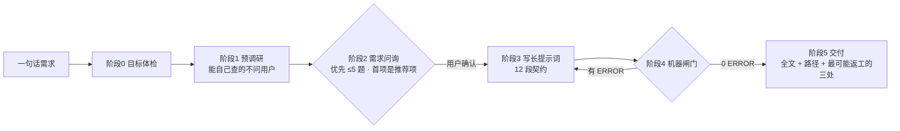

# prompt-forge

[](LICENSE)

**把「帮我做个 X」变成「AI 拿到就能直接开工的长提示词」。**

大多数人用 AI 的方式是：一句话丢过去 → AI 猜 → 出来的东西不对 → 再吵三轮。
问题不在 AI 的能力，在于**需求从没被说清楚过**：没有交付物路径、没有验收口径、没有边界、
没有"什么算做完"。prompt-forge 把"说清楚"这件事做成了一套可执行的流程：

> 一句模糊需求 → 一轮带推荐项与参考选项的问询（优先 ≤5 题，最多 9 题）→ 12 段结构的长提示词 → 机器闸门 0 ERROR → 交付。

---

## 它解决什么问题

| 直接丢给 AI | 走一遍 prompt-forge |
| --- | --- |
| 「整理一下下载文件夹」 | 4 条分类规则 + 同名冲突策略 + 不动的文件清单 + 幂等要求 |
| 「要好看、要快」 | 参照物路径 + 色值字号令牌 + 「1284 个文件 ≤ 60 秒」+ 测量方法 |
| 「别删东西」 | 非目标段 5 条 + 验收「文件数差值 = 0」+ 触发即停的卡点 |
| 「做完了」 | 每条需求配一条带 `判定：` 的验收，逐条贴命令与结果 |
| 返工靠吵架 | 未确认项全部标在「假设与开放问题」段，附默认值与改动代价 |

它不是"把话写长"，而是**把每一句都写成可判定的**。

## 它怎么工作



四个关键设计：

1. **问询是唯一强制卡点**：没拿到用户明确的「准确，开始生成」，不许开始写提示词。
2. **让用户挑，不让用户写**：每题 3~4 个选项，首项是**带理由的推荐项**，还提供参照物与反例
   （菜单见 [`references/参考样例库.md`](references/参考样例库.md)）。
3. **提示词是给陌生人看的**：把本次对话全删掉，另一个 AI 只读这个文件也要能开工。
4. **每条规矩都标出处**：`references/方法论出处.md` 里逐条写明是官方文档、行业标准，还是本仓库自己的设计选择 —— 哪些是抄的、哪些是拍的，一目了然。

## 快速开始

**方式一：装成 Agent Skill**（Claude Code / DSH / Cursor 等支持 Skills 的工具）

```bash
npx skills add hwy-miaomiao/prompt-forge
```

然后直接说需求：「帮我做个能自动整理会议纪要的小工具」。
Skill 会把产物写到 `<你的项目>/提示词/<slug>/`（记得把 `提示词/` 加进 `.gitignore`）。

**方式二：克隆直接用**

```bash
git clone git@github.com:hwy-miaomiao/prompt-forge.git
cd prompt-forge
```

让 AI 编程工具打开这个目录，它会先读 [`AGENTS.md`](AGENTS.md)，然后照阶段执行。
克隆用法下的产物落在 `输出/<slug>/`。

**先验一下闸门是好的**：

```bash
python scripts/check_prompt.py --selftest
# PASS  例1-下载文件夹整理.prompt.md: 0 ERROR（期望 0 ERROR）
# PASS  例2-班级报名网站.prompt.md: 0 ERROR（期望 0 ERROR）
# PASS  反例-模糊需求.prompt.md: 16 ERROR（期望 >=5 ERROR）
```

## 你会得到什么

`<输出目录>/prompt.md` —— 一份 12 段结构的长提示词，可以直接整段复制给任何 AI：

| # | 段落 | 作用 |
| --- | --- | --- |
| 1 | 角色与目标 | 做完算成功的定义 |
| 2 | 背景与已知事实 | 每个事实带来源标记（用户原话/仓库实测/外部资料/AI 推断） |
| 3 | 交付物 | 精确路径 + 格式 + 数量 |
| 4 | 需求（R#） | 逐条编号、每条可验证、排序即优先级 |
| 5 | 非目标 | 明确不做什么，拦住"顺手扩展" |
| 6 | 技术约束 | 语言版本、依赖、目录、风格、禁止项 |
| 7 | 验收标准（A#） | 每条引用 R#，每条有 `判定：`（命令/阈值/人工） |
| 8 | 验证方式 | 可直接粘贴的命令 + 期望输出 |
| 9 | 执行步骤 | 阶段化、每步有产物、标可中断点 |
| 10 | 假设与开放问题 | 显式标 `未确认` 与默认取值 |
| 11 | 何时必须停下来问人 | 可识别的触发条件 |
| 12 | 汇报格式 | 改了什么 / 怎么验的 / 还剩什么 |

另外还有一份 `<输出目录>/需求确认.md`：用户拍板的每一项、用户原话、每轮修改意见与影响范围。

## 需求问询长什么样

不是"你想要什么？"，而是把能查的查完，只问只有用户能回答的，并且给他选项：

```text
Q3. 交付形态（影响：交付物段落 + 验收段落）
- [推荐] 单个 Python 脚本 + 双击入口 —— 理由：你只要求"双击能跑"，脚本最容易验证也最少维护
- 带子命令的 CLI 工具（--dry-run / --undo）
- 带界面的小应用（要额外写 UI，工期约 ×2）
- 都可以 / 你决定
```

「你决定」也是合法答案：会变成一个带默认值的显式假设，而不是一条偷偷拍板的决定。

## 机器闸门

```bash
python scripts/check_prompt.py 输出/<slug>/prompt.md
```

拦住 13 类结构问题（缺段落、需求/验收条数不足、编号重复、验收没引用需求、验收没有判定方式、
需求没被验收覆盖、非目标写成"无"、交付物没路径、需求段出现模糊词、残留占位符……），
全部检查项与修法见 [`references/校验清单.md`](references/校验清单.md)。

- **ERROR 共 13 个码**（`E0`~`E10`，其中编号重复另算 `E2b` / `E3b`）；
- **WARN 另有 8 个码**（`W1`~`W7`、`W9`）：全文过短、需求没有可验证对象、假设段为空、
  需求/验收条目过多、非目标只写 1 条、一句多需求、非需求段出现模糊词。

**0 ERROR 才允许交付**；WARN 要逐条说明为什么不影响执行。
机器只管结构，需求对不对仍然要靠问询与人工复核 —— 闸门是拦低级错误的，不是质量保证。

## 目录结构

```text
prompt-forge/
├── AGENTS.md            # 工作规范（唯一权威，AI 先读这个）
├── SKILL.md             # 装成 Agent Skill 时的入口
├── CLAUDE.md            # 让 Claude Code 也读 AGENTS.md
├── README.md
├── references/          # 需求问询 · 参考样例库 · 提示词结构 · 模糊词换算表 · 校验清单 · 踩坑记录 · 方法论出处
├── templates/           # 提示词骨架 · 需求确认模板
├── scripts/
│   └── check_prompt.py  # 唯一机器闸门（含 --selftest）
├── examples/            # 两个正例 + 一个反例（正例必须过闸门）
└── 输出/                # 克隆用法下的产物目录（git 忽略）
```

## 常见问题

**它需要联网吗？**
不需要。全部是本地 Markdown 与一个零依赖 Python 脚本（Python ≥3.9）；联网只用于阶段 1 预调研时查资料。

**会不会把提示词写得很长很啰嗦？**
长度由信息量决定，不是目标。经验区间：脚本类 400~900 字，Web 类 800~2000 字。
判据是"删掉这句，执行结果会不会变"——不会就删。

**可以直接让 AI「帮我写个提示词」吗？**
可以，但那就是现在大家都在做的事：AI 猜你的需求，然后你返工。
prompt-forge 的价值在于**流程约束**：先问、给参考、验证、留假设，最后才落笔。

**只支持中文需求吗？**
流程与文档是中文优先，输入任意语言都行；产出的提示词语言跟随你的输入。

**能配合 Claude Code / Cursor / DSH 用吗？**
能。`AGENTS.md` 是通用规范，`SKILL.md` 供支持 Agent Skills 的工具加载，
产物是纯 Markdown，任何 AI 都能读。

## 参与贡献

欢迎提 Issue 与 PR：新的参考样例、新的需求形态题库、新的闸门检查项，或者一条你自己踩过的坑
（`references/踩坑记录.md` 的格式是「症状 → 原因 → 正确做法」，照这个写就行）。

改动 `scripts/check_prompt.py` 或 `examples/` 之后，请确保 `--selftest` 仍然全绿。

## 协议

[MIT](LICENSE) © 2026 hwy-miaomiao
