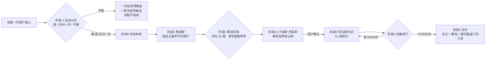

# prompt-forge

[](LICENSE)
[](https://github.com/hwy-miaomiao/prompt-forge/actions/workflows/ci.yml)

**简体中文** | [English](README.en.md)

**把「帮我做个 X」变成「AI 拿到就能直接开工的长提示词」。**

大多数人用 AI 的方式是：一句话丢过去 → AI 猜 → 出来的东西不对 → 再吵三轮。
问题不在 AI 的能力，在于**需求从没被说清楚过**：没有交付物路径、没有验收口径、没有边界、
没有"什么算做完"。prompt-forge 把"说清楚"这件事做成了一套可执行的流程：

> 任意一句需求 → **自动分诊**（该接就接，不该接就一句话说清理由）→ 一轮带推荐项与参考选项的问询（优先 ≤5 题，最多 9 题）→ 一份「写多厚」的扩充菜单（每项自带默认档）→ 12 段结构的长提示词 → 闸门①、③ 0 ERROR → 交付。

**不用背触发词。** 它不靠「帮我做个 X」这类固定句式触发：宿主把技能的 `name` + `description`
交给模型，模型按语义判断这次输入该不该用它。所以描述里同时写清了"什么时候该用"和"什么时候不该用" ——
判成不该用时，它只说一句话并给出更合适的做法，不会擅自启动流程。

---

## 它解决什么问题

| 直接丢给 AI | 走一遍 prompt-forge |
| --- | --- |
| 「整理一下下载文件夹」 | 4 条分类规则 + 同名冲突策略 + 不动的文件清单 + 幂等要求 |
| 「要好看、要快」 | 参照物路径 + 色值字号令牌 + 「1284 个文件 ≤ 60 秒」+ 测量方法 |
| 「别删东西」 | 非目标段 5 条 + 验收「文件数差值 = 0」+ 触发即停的卡点 |
| 「做完了」 | 每条需求配一条带 `判定：` 的验收，逐条贴命令与结果 |
| 返工靠吵架 | 未确认项全部标在「假设与开放问题」段，附默认值与改动代价 |

它不是"把话写长"，而是**把每一句都写成可判定的**。

## 它怎么工作



七个关键设计：
1. **不用背触发词**：唯一的路由面是 `SKILL.md` 的 `description`，模型按语义判断要不要用它；
   接住之后的第一件事是**把判断说出口** —— 接（`go`）/ 先问一句（`needs-clarification`）/ 不接（`kill`），
   三态沿用 GitHub spec-kit 的说法。判据三条：有没有能落下来的交付物、是不是一次任务级的活、
   缺的信息能不能自己查到。
2. **问询是唯一强制卡点**：没拿到用户明确的「准确，开始生成」，不许开始写提示词。
3. **让用户挑，不让用户写**：每题 3~4 个选项，首项是**带理由的推荐项**，还提供参照物与反例
   （菜单见 [`references/参考样例库.md`](references/参考样例库.md)）。
4. **菜单只问「写多厚」，不问「做什么」**：阶段 2.5 的扩充菜单管的是这份提示词要不要包含性能预算、
   错误处理、测试这类东西 —— **每一项都带默认档**，一个都不勾就等于直接给默认值
   （官方口径是 "Provide defaults, not menus"，本仓库的折中见 [`references/方法论出处.md`](references/方法论出处.md) 第 4.5 节）。
5. **提示词是给陌生人看的**：把本次对话全删掉，另一个 AI 只读这个文件也要能开工。
6. **每条规矩都标出处**：`references/方法论出处.md` 里逐条写明是官方文档、行业标准，还是本仓库自己的设计选择 —— 哪些是抄的、哪些是拍的，一目了然。
7. **闸门自己也被检验**：三道闸门都是零依赖脚本，`--selftest` 拿真实正反例跑；另有 `scripts/mutate_checks.py`
   把闸门源码改坏 48 处，每一处都必须让对应的自测变红 —— 防的是"自测空跑、看着全绿其实什么都没查"。

## 快速开始

**方式一：装成 Agent Skill**（Claude Code / DSH / Cursor 等支持 Skills 的工具）

```bash
npx skills add hwy-miaomiao/prompt-forge
```

然后直接说需求：「帮我做个能自动整理会议纪要的小工具」。
Skill 会把产物写到 `<你的项目>/提示词/<slug>/`（记得把 `提示词/` 加进 `.gitignore`）。

**方式二：克隆直接用**

```bash
git clone git@github.com:hwy-miaomiao/prompt-forge.git
cd prompt-forge
```

让 AI 编程工具打开这个目录，它会先读 [`AGENTS.md`](AGENTS.md)，然后照阶段执行。
克隆用法下的产物落在 `输出/<slug>/`。

**先验一下三道闸门都是好的**：

```bash
# 闸门①：检查产出的长提示词本身（12 段契约）
python scripts/check_prompt.py --selftest
# PASS  例1-下载文件夹整理.prompt.md: 0 ERROR（期望 0 ERROR）
# PASS  例2-班级报名网站.prompt.md: 0 ERROR（期望 0 ERROR）
# PASS  例3-logsift-json-export.prompt.md: 0 ERROR（期望 0 ERROR）
# PASS  反例-模糊需求.prompt.md: 16 ERROR（期望 >=5 ERROR）
# PASS  templates/提示词骨架.md: 0 ERROR, 0 WARN（期望 0 ERROR 0 WARN）
# …… 共 103 个用例 = 这 5 个真实文件 + 98 个内置回归（标题绑定与抢绑、模糊词豁免、
#      围栏里的 R# 样例不算条目 / 围栏里的标题不算段落 / ~~~ 也是围栏、
#      围栏里的 TODO 仍报 E10、A# 的引用写在续行也算数、W8 同义标题歧义、
#      豁免注释只吃同一段的 WARN / 缺理由与写错码报 E11 / --no-ignore 时豁免失效
#      四反引号围栏不提前闭合、5 级与 setext 标题、A4 纸不算验收编号、缩进代码块不算条目、
#      同名段不串豁免、多行豁免注释、UTF-16 BOM、代码块前的 E9 行号不漂
#      —— 含文案断言：绑定落在没编号那条时，W8 必须说清选的是哪条）

# 闸门②：检查本技能自己的定义（description 能不能被自动识别、name 会不会让技能静默失效）
python scripts/check_skill.py --selftest
# PASS  SKILL.md: 0 ERROR（期望 0 ERROR）
# PASS  [闸门] 正例夹具: ERROR 码 []（期望 []）
# …… 共 56 个用例（其中 2 个目录链接用例在 Linux 用符号链接、Windows 用 junction 真跑；
#      两者都建不了的环境会 SKIP，不算失败）
#      = 真实 SKILL.md + 9 个真实示例 + 46 个内置闸门用例（含行号、BOM、长句触发、
#      `go` 不被 `good` / `Go 语言` 命中、「不接（kill）」不算写了「接」等）

# 闸门③：检查段与段之间对不对得上（需求↔步骤、未确认↔停下条件、判定↔命令）
python scripts/check_contract.py --selftest
# PASS  [闸门③] 基准件：闸门① 的自测夹具跨段也对得上: ERROR 码 []（期望 []） WARN 码 []（期望 []）
# PASS  [闸门③] C1 引用了不存在的需求号: ERROR 码 ['C1']（期望 ['C1']） WARN 码 []（期望 []）
# …… 共 35 个用例 + 2 个 --no-ignore 用例 + 1 个行号用例 + 2 个范围说明用例
#      （C1/C3 是 ERROR，C2/C4/C5 是 WARN；最后两条是「范围说明」用例：没东西可查 / 有需求但缺第 9 段、C2 无从检查）

# 变异检验：把闸门源码改坏 48 处，每一处都必须让对应的自测变红（自测空跑过一次，见踩坑记录 #29）
python scripts/mutate_checks.py
```

## 你会得到什么

`<输出目录>/prompt.md` —— 一份 12 段结构的长提示词，可以直接整段复制给任何 AI：

| # | 段落 | 作用 |
| --- | --- | --- |
| 1 | 角色与目标 | 做完算成功的定义 |
| 2 | 背景与已知事实 | 每个事实带来源标记（用户原话/仓库实测/外部资料/AI 推断） |
| 3 | 交付物 | 精确路径 + 格式 + 数量 |
| 4 | 需求（R#） | 逐条编号、每条可验证、排序即优先级 |
| 5 | 非目标 | 明确不做什么，拦住"顺手扩展" |
| 6 | 技术约束 | 语言版本、依赖、目录、风格、禁止项 |
| 7 | 验收标准（A#） | 每条引用 R#，每条有 `判定：`（命令/阈值/人工） |
| 8 | 验证方式 | 可直接粘贴的命令 + 期望输出 |
| 9 | 执行步骤 | 阶段化、每步有产物、标可中断点，每步写 `（对应 R#）` |
| 10 | 假设与开放问题 | 显式标 `未确认` 与默认取值，每条在第 11 段有对应的停下条件 |
| 11 | 何时必须停下来问人 | 可识别的触发条件（接住第 10 段的每一条） |
| 12 | 汇报格式 | 改了什么 / 怎么验的 / 还剩什么 |

另外还有一份 `<输出目录>/需求确认.md`：用户拍板的每一项、用户原话、每轮修改意见与影响范围。

## 需求问询长什么样

不是"你想要什么？"，而是把能查的查完，只问只有用户能回答的，并且给他选项：

```text
Q3. 交付形态（影响：交付物段落 + 验收段落）
- [推荐] 单个 Python 脚本 + 双击入口 —— 理由：你只要求"双击能跑"，脚本最容易验证也最少维护
- 带子命令的 CLI 工具（--dry-run / --undo）
- 带界面的小应用（要额外写 UI，工期约 ×2）
- 都可以 / 你决定
```

「你决定」也是合法答案：会变成一个带默认值的显式假设，而不是一条偷偷拍板的决定。

## 机器闸门

交付 `prompt.md` 要求闸门①、③ 都 0 ERROR；闸门② 在改了 `SKILL.md` / `AGENTS.md` / `references/` 之后单独跑；另有一个变异检验，专门证明这三道自测不是空跑。

**闸门①：长提示词本身**

```bash
python scripts/check_prompt.py <输出目录>/prompt.md
```

其中 `<输出目录>`：克隆用法是 `输出/<slug>/`，安装成 Skill 的用法是 `提示词/<slug>/`（见上文「快速开始」）。

拦住这些结构问题：缺段落、需求/验收条数不足、编号重复、验收没引用需求、验收没有判定方式、
需求没被验收覆盖、非目标写成"无"、交付物没路径、需求段出现模糊词、残留占位符。
全部检查项与修法见 [`references/校验清单.md`](references/校验清单.md)。

- **ERROR 共 14 个码**（`E0`~`E11`，其中编号重复另算 `E2b` / `E3b`）；
- **WARN 另有 9 个码**（`W1`~`W9`）：全文过短、需求没有可验证对象、假设段为空、
  需求/验收条目过多、非目标只写 1 条、一句多需求、非需求段出现模糊词、
  同义标题绑定歧义。`W8` 只在这两种形态报：① 一条带编号 + 一条没编号；② 段内还有一条**级别相同**的
  候选标题（都带编号或都没编号）—— 只要同段还存在同级候选就提醒，不看谁排在前面。
  绑定优先选「段内真的写了本段条目」的那条，其次才看带不带编号、号数对不对、文档顺序，
  并把另一条标题和它的行号一并报出来；`## 4. 需求（R#）` 下面再挂一条 `### 4.1 需求补充说明`
  是子标题（级别不同），**不算**歧义。
  其中 `W8` 只是**歧义预警**：需求段与验收段的模糊词是按「标题别名命中」判的（命中即 `E9`），
  所以绑定选错不会把 ERROR 静默降级成 WARN，W8 提示的是"该段标题有两种写法在打架，改掉一条"。

**闸门②：这个技能自己的定义**

```bash
python scripts/check_skill.py SKILL.md
python scripts/check_skill.py --selftest   # 56 个用例（2 个链接安装用例：Linux 符号链接 / Windows junction 真跑；两者都建不了的环境会 SKIP）
```

查的是「自动识别」这件事能不能成立：

- `name` 是不是 kebab-case、**是否与所在目录名一致**（目录包形态就是 `<name>/SKILL.md`）；
- `description` 有没有超过规范上限（1024 字符），前 500 字里有没有写清**什么时候该用**与**什么时候不该用**
  （有的宿主只渲染前 500 字。`whenToUse` 帮不上路由：DSH 的目录条目只把 `name` + 截断后的
  `description` 交给模型，`whenToUse` 根本不渲染 —— 见 `references/方法论出处.md` 第 4.5 节、
  `references/踩坑记录.md` 第 21 条）；
- 正文**声称了**分诊三态 / **引用了同目录的 `AGENTS.md`** / **给了**菜单时，对应的三态、
  「动手前先读完」、"每项自带默认档"有没有写清 —— 不声称就不查：一份与 prompt-forge 无关的自足技能不该被我们的家规拦下；
  但「描述里要写清何时该用 / 何时不该用」对**任何**技能都查（这是官方判据，不是家规）；
- 正文**引用**的 `AGENTS.md` / `references/` / `scripts/check_prompt.py` 是否真的都在同目录
  （只拷 `SKILL.md` 是最常见的安装事故）。只有"同目录"才算数：`../AGENTS.md`、绝对路径不算缺件，
  而且只查**被引用的**那几个路径。

**为什么要专门有一道闸门**：技能定义写错往往**没有报错**。有的宿主只打一条 warning，模型侧
什么诊断都收不到，表现为"这个技能好像没装"。闸门②把它变成一个会红的东西。

**闸门③：段与段之间对不对得上**

```bash
python scripts/check_contract.py <输出目录>/prompt.md
python scripts/check_contract.py --selftest   # 35 个用例 + 2 个 --no-ignore 用例 + 1 个行号用例 + 2 个范围说明用例
```

段落本身写得对（那是闸门① 的活）不等于**段与段对得上**：

- `C1`（ERROR）引用了不存在的编号 —— 第 9 段写「（对应 R7）」，可第 4 段只到 R5；
- `C3`（ERROR）第 10 段列了 `未确认`，第 11 段却空着或只写「无」—— 用户答不上来的那件事没人兜底；
- `C2`（WARN）某条 `R#` 没被第 9 段任何一步触及 —— 这条需求没人干；
- `C4`（WARN）某条 `未确认` 在第 11 段找不到对应（两边没有一个共同的关键词）；
- `C5`（WARN）某条验收写着 `判定：命令`，条目里却没有一条能直接粘贴的命令。

写法上只要守两条：**第 9 段每个步骤写 `（对应 R#）`**、**第 10 段每条 `未确认` 在第 11 段有一条停下条件**。

**豁免注释**：确属「这条 WARN 在这个语境下不必改」时，可以在**同一段**里写
`<!-- pf-ignore: W2 这条的量化写在配对的 A# 里 -->` —— 只对 WARN 生效、必须写理由（写太短也报 `E11`），
码写错或格式不对也报 `E11`；用 `--no-ignore` 可以看到被豁免的全部条目。
豁免是例外而非常态：默认做法是改掉它。

**这三道闸门与那个变异检验都在 CI 里跑**

[`.github/workflows/ci.yml`](.github/workflows/ci.yml) 里，Python 3.9 与 3.12 两头都跑一遍
（三份 `--selftest` + `mutate_checks.py`），另外还检查三件仓库级的事：
本仓库自己的资产（三个正例、提示词骨架、`SKILL.md`）必须过闸门、反例必须被拦下、仓库文本必须是 LF。

**闸门①、③ 0 ERROR 才允许交付**；WARN 要逐条说明为什么不影响执行。
机器只管结构，需求对不对仍然要靠问询与人工复核 —— 闸门是拦低级错误的，不是质量保证。

## 目录结构

```text
prompt-forge/
├── AGENTS.md            # 工作规范（唯一权威，AI 先读这个）
├── SKILL.md             # 装成 Agent Skill 时的入口
├── CLAUDE.md            # 让 Claude Code 也读 AGENTS.md
├── README.md
├── README.en.md         # 英文说明（与 README.md 互链）
├── .github/workflows/   # CI：三份自测 + 变异检验 + 三件仓库级检查（资产过闸门 / 反例被拦下 / 全 LF）
├── references/          # 需求问询 · 参考样例库 · 提示词结构 · 模糊词换算表 · 校验清单 · 踩坑记录 · 方法论出处
├── templates/           # 提示词骨架 · 需求确认模板
├── scripts/
│   ├── check_prompt.py   # 闸门①：检查产出的长提示词本身（含 --selftest）
│   ├── check_skill.py    # 闸门②：检查本技能自己的定义能否被自动识别（含 --selftest）
│   ├── check_contract.py # 闸门③：检查 12 段之间对不对得上（含 --selftest）
│   └── mutate_checks.py  # 变异检验：把闸门源码改坏，自测必须变红
├── examples/            # 闸门①的正反例：三个正例 + 一个反例（正例必须过闸门）
│   └── 技能定义/         # 闸门②的正反例：1 正 8 反，预期 ERROR/WARN 码见该目录 README
├── 输出/                # 克隆用法下的产物目录（git 忽略）
```

## 常见问题

**它需要联网吗？**
不需要。全部是本地 Markdown 与三个零依赖 Python 脚本（`scripts/check_prompt.py`、`scripts/check_skill.py`、
`scripts/check_contract.py`，Python ≥3.9）；联网只用于阶段 1 预调研时查资料。
`scripts/mutate_checks.py` 也只是把仓库复制到临时目录、把闸门源码改坏再跑一遍自测，同样不联网。

**CI 红了怎么办？**
看是哪一步红的，各自对着修：三份自测红 → 闸门脚本本身有 bug，或示例/模板过期；
`mutate_checks.py` 红 → 有一处变异没被自测抓住（说明自测在那一点上是摆设，先补反例再改代码）；
「自家资产要过闸门」红 → 仓库里的正例 / 提示词骨架 / `SKILL.md` 被改出了 ERROR；
「反例必须被拦下」红 → 闸门漏检（`examples/反例-模糊需求.prompt.md` 现在不该通过），或者反例文件被删、闸门脚本崩溃 —— 该步骤的 `::error::` 会写明是哪种；
LF 检查红 → 索引里有文件被写成 CRLF 或混合行尾（`git ls-files --eol` 的 `i/` 列，见 `.gitattributes`；`references/踩坑记录.md` 里有几条换行相关的坑）。

**会不会把提示词写得很长很啰嗦？**
长度由信息量决定，不是目标。经验区间：脚本类 400~900 字，Web 类 800~2000 字。
判据是"删掉这句，执行结果会不会变"——不会就删。

**我需要说什么咒语它才会触发？**
不需要。它靠技能描述做语义匹配，不靠固定句式；判成不该用时，它只说一句话 + 给更合适的做法。
反过来说，光有描述也不保证一定触发 —— 宿主可能判断这次任务是单步的、或者上下文已经够了。
想稳一点，直接说「用 prompt-forge 把这段需求问询一遍」也行。

**为什么在这个宿主里它没被触发？**
技能要能自动触发，宿主得先把技能目录交给模型：扫描根（项目级 `.dsh/skills`、`.agents/skills`，用户级 `skills/`）、
技能提供方插件、模型侧的工具，三样都得就位。任何一环没开，模型侧看到的就是"没有这个技能"，
而且**通常不会有任何报错**（见 [`references/踩坑记录.md`](references/踩坑记录.md) 第 19 条）。
自检顺序：① 目录包形态对不对（`<name>/SKILL.md`，`name` 与目录同名）；②
`python scripts/check_skill.py <技能目录>/SKILL.md` 是不是 0 ERROR；③ 宿主里到底有没有列出这个技能。
换个用法也行：直接打开本仓库（或把 `AGENTS.md` 放进工作区）——`AGENTS.md` 是工作区规范，会被读进来，
流程照样跑，只是不经过"技能自动触发"那条路。

**可以直接让 AI「帮我写个提示词」吗？**
可以，但那就是现在大家都在做的事：AI 猜你的需求，然后你返工。
prompt-forge 的价值在于**流程约束**：先分诊、再问、给参考、验证、留假设，最后才落笔。

**只支持中文需求吗？**
流程与文档是中文优先，输入任意语言都行；产出的提示词语言跟随你的输入。

**能配合 Claude Code / Cursor / DSH 用吗？**
能。`AGENTS.md` 是通用规范，`SKILL.md` 供支持 Agent Skills 的工具加载，
产物是纯 Markdown，任何 AI 都能读。

## 参与贡献

欢迎提 Issue 与 PR：新的参考样例、新的需求形态题库、新的闸门检查项，或者一条你自己踩过的坑
（`references/踩坑记录.md` 的格式是「症状 → 原因 → 正确做法」，照这个写就行）。

改动 `scripts/*.py`、`templates/`、`SKILL.md`、`AGENTS.md`、`references/` 或 `examples/` 之后，请确保三份自测仍然全绿
（改过 `SKILL.md`、`AGENTS.md` 或 `references/` 还要单独跑 `check_skill.py`）：

```bash
python scripts/check_prompt.py --selftest
python scripts/check_skill.py --selftest
python scripts/check_contract.py --selftest
python scripts/check_skill.py SKILL.md   # 改过 SKILL.md / AGENTS.md / references/ 之后要跑
python scripts/mutate_checks.py     # 动了闸门源码就要跑：48 处变异必须全部被抓住
```

新增检查项时请补上反例，并且**先用真实文件跑一遍确认期望的 ERROR 码** —— 照直觉写期望值，
自测就会变成"永远通过"的摆设；再把这道新检查的关键一行加进 `scripts/mutate_checks.py` 的 `MUTATIONS`，
这样"自测被改瞎"本身也会红。上面这几条 CI 都会替你跑一遍（Python 3.9 与 3.12 两头）。

**本机只有 3.12 时**，别指望本机全绿就等于 3.9 也能跑 —— 这里真踩过一次：
`Path.write_text(newline="\n")` 是 3.10+ 的参数，本机全绿、CI 的 3.9 那一格却红（`references/踩坑记录.md` #42）。
Windows 上不用装 Python：官方 embeddable 包解压就能跑（脚本零依赖，8.6 MB）：

```powershell
curl.exe -LO https://www.python.org/ftp/python/3.9.13/python-3.9.13-embed-amd64.zip
Expand-Archive python-3.9.13-embed-amd64.zip -DestinationPath py39
& .\py39\python.exe -X utf8 -B scripts\check_prompt.py --selftest
& .\py39\python.exe -X utf8 -B scripts\check_skill.py --selftest
& .\py39\python.exe -X utf8 -B scripts\check_contract.py --selftest
& .\py39\python.exe -X utf8 -B scripts\mutate_checks.py
```

macOS / Linux 没有 Windows 嵌入包（那个 zip 里只有 `python.exe` 和 `.pyd` / `.dll`，解压后没有 `py39/python`），
要装一个真正的 CPython 3.9 —— 3.12 不算数，测不出 3.9 才有的问题：

```bash
# macOS：装 python.org 的 3.9 安装包（https://www.python.org/downloads/release/python-3913/）
# Debian / Ubuntu：用 deadsnakes PPA（Ubuntu 24.04 默认仓库只有 3.12，实测这条可用）
sudo add-apt-repository -y ppa:deadsnakes/ppa
sudo apt-get update && sudo apt-get install -y python3.9
# 其他发行版：pyenv install 3.9.13（或 uv python install 3.9.13）

# 装好后用 python3.9 跑这四条（与 CI 的 3.9 那一格等价；不在 PATH 时用安装包给的完整路径）
python3.9 -X utf8 -B scripts/check_prompt.py --selftest
python3.9 -X utf8 -B scripts/check_skill.py --selftest
python3.9 -X utf8 -B scripts/check_contract.py --selftest
python3.9 -X utf8 -B scripts/mutate_checks.py
```

## 协议

[MIT](LICENSE) © 2026 hwy-miaomiao
